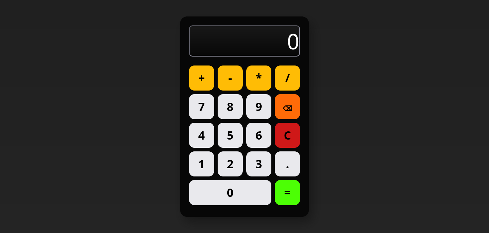
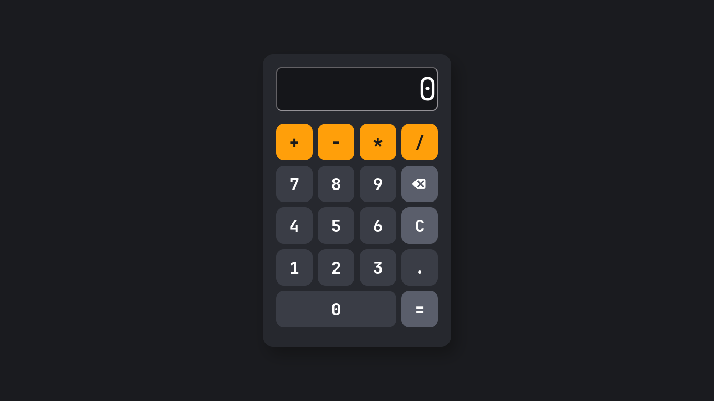

# Projeto

### Calculadora

Projeto desenvolvido durante meus estudos de JavaScript com foco em manipulação do DOM, eventos e lógica de programação.

## Funcionalidades

- Operações básicas
- Impede operadores repetidos
- Não permite iniciar com operador
- Controle de ponto decimal
- Botão apagar
- Botão limpar
- Validação antes do cálculo

## Imagem

### Atualização
---

## Tecnologias

- HTML
- CSS
- JavaScript

## Aprendizados

- Manipulação do DOM
- addEventListener
- querySelector
- forEach
- includes
- lastIndexOf
- slice
- eval (temporariamente)
- Organização de funções
- Validação de entrada
